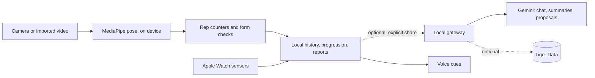

# Spottr

Native iPhone + Apple Watch training companion for OxHack 2026. Repository: [NakkiV7/oxhack-team](https://github.com/NakkiV7/oxhack-team).

<!-- NEW: badges. Only things that exist in the repo today; see docs/ROADMAP.md for what is verified. -->


<!-- NEW: hero. Replace with a real recording (5 to 10 s: live camera, skeleton, rep count). Put it in docs/media/. -->
<p align="center"></p>

The working baseline includes on-device MediaPipe push-up/squat tracking, camera and imported-video sessions, manual workout logging, timed holds, a 19-exercise library, local history, skill progression and deterministic session/week reports. Most exercises use manual logging or a timer; only push-ups and squats currently have camera tracking. Attribute points are game progress, not measured physiology. There is no sign-in or cloud sync requirement for the local demo.

Provider integrations and physical-device evidence have separate acceptance gates. A passing simulator test does not establish rep accuracy or real Watch sensor capture. See [roadmap and evidence gates](docs/ROADMAP.md) before describing a sponsor integration as connected.

## At a glance

<!-- NEW. Screenshots: replace the placeholders with real images in docs/media/. -->
| Today / session | Camera tracking | Coach |
|---|---|---|
|  |  |  |
| TODO caption | TODO caption | TODO caption |

| Apple Watch | Hardware / landing page |
|---|---|
|  |  |
| TODO caption | TODO caption |

How the pieces connect (offline-first; gateway and providers are optional):



Status per track, with the acceptance gate for each, is in [docs/ROADMAP.md](docs/ROADMAP.md). Short version (✅ implemented, 🚧 in progress, ⏳ not started; "verified" still needs its named check):

| Track | Owner | State |
|---|---|---|
| Push-up counting | @azhar-rafiq | ✅ baseline, 🚧 validation on labelled clips (test plan in `prototype/pushup/docs/TEST_PLAN.md`, no accuracy claim yet) |
| Squat counting | @NakkiV7 | ✅ baseline, 🚧 validation on labelled clips |
| Manual/timed logging, progression, reports | @omariosc | ✅ local implementation |
| Gemini chat, summaries, proposals | @omariosc | 🚧 gateway and contracts, live provider run pending |
| Voice (ElevenLabs) and landing page | @MishaGitnik | ⏳ |
| Physical Watch, Vultr, Tiger, Snowflake, HRT, Presage, Arduino | @omariosc | 🚧 / ⏳ see roadmap |

## Start locally

Use a Mac with Xcode and installed iOS 26/watchOS 26 SDKs, Ruby with the `xcodeproj` gem, and the Xcode command-line tools selected. The Foundation-only package needs Swift 6. The optional gateway needs Node 22.9+ and npm. Bootstrap checks prerequisites and explains missing ones; it never installs packages, uses sudo, creates simulators or erases devices.

```bash
git clone https://github.com/NakkiV7/oxhack-team.git
cd oxhack-team
git switch -c feat/your-feature
./scripts/bootstrap.sh
cd server && npm ci && cd ..
./scripts/check.sh
open Spottr.xcodeproj
```

Bootstrap downloads only missing, pinned MediaPipe 1.1.1 XCFrameworks, verifies their archive hashes and regenerates the Xcode project. The model is already bundled. Dependency provenance is in [THIRD-PARTY.md](Native/Resources/THIRD-PARTY.md). The app needs no provider keys to use local training and reports.

In Xcode, select `Spottr` and an **existing** iPhone simulator. Use `xcrun simctl list devices available` to find your own device; for Watch work select an existing paired Watch and `SpottrWatch`. Reuse installed devices; do not automatically create or erase them. Physical phone/Watch builds need your own signing team and a matching phone/Watch bundle-ID pair. Coordinate generator changes before sharing signing edits.

The generated targets currently require iOS/watchOS 26; the standalone shared package supports older platforms. `./scripts/check.sh --static` checks shell/Ruby/JSON/JavaScript syntax only. Normal `check.sh` additionally runs the offline Swift and gateway tests and requires installed gateway dependencies. Native XCTest/UI checks are manual in Xcode (`Product → Test`) against your selected existing simulator. No CI/CD is configured.

## Optional local gateway and keys

```bash
cp .env.example .env
# Edit .env privately, then:
cd server
npm ci
npm test
npm start
```

For hidden key entry, run `./scripts/local-config.py GEMINI_API_KEY` (Python 3). Running the helper without a key initializes an ignored `.env` and a random local gateway token. It prints no values; copy the gateway token privately from `.env` into Coach settings.

Use the variable descriptions in [.env.example](.env.example) and the [gateway setup](integrations/gateway/README.md). `.env` is ignored. Keep Gemini, database and other provider credentials on the server. The app receives only the gateway base URL and its separate gateway access token through local settings. Do not put provider keys in Swift, Xcode build settings, a committed plist, screenshots or PR text. Use a per-developer local token; a shared hackathon token is not production identity management.

The gateway defaults to `http://127.0.0.1:8787`; `GET /health` reports configuration without a provider call. Health readiness and a configured key do not prove a provider request succeeded. In **Coach → Coach settings** (sliders), enter the gateway URL and gateway access token, then save. The app stores the token in this-device Keychain. It accepts HTTPS and permits HTTP for localhost development; a physical phone needs a reachable HTTPS gateway. A remote deployment must provide its own authentication and transport hardening.

Use Send, Propose or Generate summary to explicitly share recent saved sets and skill game points; raw sensor telemetry is not part of that request. Proposals start unselected: choose exercises, then **Approve & save selected exercises** to save a checklist. Each checklist item's Log action opens the manual logger; the camera foundation session remains a separate flow. Cancel/failure/invalid coaching preserves local reports and the current plan. See the gateway README for current routes and restrictions.

## Push-up CV prototype

A standalone Node prototype for exploring the push-up counter. It is a reference for the native counter, not a replacement for it. Full guide: [prototype/pushup/README-pushup.md](prototype/pushup/README-pushup.md).

```bash
cd prototype/pushup
npm install
npm run setup   # downloads the pose model into models/ (gitignored)
npm test        # offline rep-counter and guardrail tests
npm run ui      # http://localhost:3001
```

**Supported setup:** camera side-on to the user, one person in frame, whole body visible, about 2 to 3 m away.

**Known limitations:**

- Thresholds are untuned guesses and have not been measured on labelled clips. There is no count-accuracy claim yet.
- A 2D side view cannot judge elbow flare or scapular issues. This is not a form-certified or medical tool.
- Wall push-ups only check for one straight line, not sag or pike direction.
- The prototype's Gemini coach reads its own `GEMINI_API_KEY` from `prototype/pushup/.env`. It is separate from the app's gateway (Coach tab) and is not wired into the native build.

**Next:** consented side-view clips, count-error and cue measurements, then an exercise-specific push-up policy with landmark-fixture tests. Edits to `PoseGeometry.swift` and `RepCounter.swift` are agreed with the squat owner first.

## Pick up a feature

- [Team ownership and help wanted](docs/TEAM.md): claim a branch and file boundary before editing.
- [Contributing](CONTRIBUTING.md): small feature PRs, local checks, generated-project coordination and smoke tests.
- [Assigned GitHub issues](docs/ISSUES.md): current work, owners and suggested branches.
- [Roadmap](docs/ROADMAP.md): acceptance criteria and dependencies for each track.

Push-up CV belongs to [@azhar-rafiq](https://github.com/azhar-rafiq); squat CV to [@NakkiV7](https://github.com/NakkiV7); ElevenLabs voice and the landing page to [@MishaGitnik](https://github.com/MishaGitnik). [@omariosc](https://github.com/omariosc) owns the remaining tracks and integration. Both CV paths already have baselines: start with tests, calibration and observed errors.

## Source map

| Path | Purpose |
|---|---|
| `Native/iOS`, `Native/Watch` | SwiftUI app, camera/model pipeline, Watch companion and sensors |
| `Shared/Core` | Foundation-only session, exercise, progression, report and coach contracts |
| `Shared/Apple` | Apple companion transport |
| `Tests/Core`, `Tests/iOS`, `Tests/UI` | Offline behavior, native pipeline and UI checks |
| `server` | Optional local gateway; credentials stay here at runtime |
| `integrations` | Provider contracts, schemas, SQL preparation and integration setup |
| `scripts` | Pinned SDK fetch, Xcode generator and local checks |
| `prototype/pushup` | Standalone push-up prototype, not part of the native build: web page (MediaPipe + rep state machine, standard/knee/incline/wall variations), a small iPhone display app in `ios/`, and an experimental Gemini coach with cited Q&A. It has its own `.env` and does not use the gateway. Thresholds are untuned guesses. See `README-pushup.md` there. |
| `design`, `research`, `docs` | Existing approved graphics, research and historical design notes |

Historical design documents describe intentions at their recorded date; source and the current evidence ledger take precedence for implementation status. Existing images are available for the demo; generation of additional images is paused.

## Prizes we are aiming for

<!-- NEW. Targets, not claims: claim a sponsor integration only once its roadmap row is verified. -->
| Prize | Track |
|---|---|
| Best Use of Gemini API (MLH) | Gemini chat, summaries, proposals |
| Best Use of ElevenLabs (MLH) | Voice cues |
| Best Use of Tiger Data (MLH) | Time-series ingestion and rollups |
| Best Use of Snowflake API, Vultr, Presage (MLH) | Optional tracks, see roadmap |
| DEV Writing Challenge (MLH) | Write-up, after the evidence ledger |
| HRT: Best of Data for Predictions and Decision Making | Rest-HR forecast research |
| Zed: Built with Delta | Delta prompt evaluation, see [plan](docs/delta-prompt-evaluation.md) |
| Best Handmade Project, overall prizes | Arduino companion, whole demo |

Event: [OxHack 26](https://26.oxhack.net) and [Devpost](https://oxhack-2026.devpost.com/).
