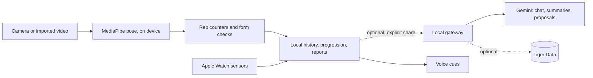

# Spottr

Native iPhone + Apple Watch training companion for OxHack 2026. Repository: [NakkiV7/oxhack-team](https://github.com/NakkiV7/oxhack-team).


The working baseline includes on-device MediaPipe push-up/squat tracking, manual and timed custom workouts, a 19-exercise library with lessons and private demo-video imports, local profiles/goals, connected skill progression and deterministic session/week reports. Most exercises use manual logging or a timer; only push-ups and squats currently have camera tracking. Attribute points are game progress, not measured physiology. Local training needs no sign-in or cloud sync.

Start with the [morning handoff](docs/morning-handoff.md) for the current MVP, startup steps, owners and device checks. Merged milestones through [PR #69](https://github.com/NakkiV7/oxhack-team/pull/69) include profile-aware Coach, Pi/local voice, mixed camera/manual workout plans, public-data research, the judges' guide and reduced repeated work in Skills/history. Provider integrations and physical-device evidence have separate acceptance gates. A passing simulator test does not establish rep accuracy or real Watch sensor capture. The [current evidence ledger](docs/integration-readiness.md) distinguishes implemented, offline-tested, live and pending paths.

## What the demo can show

- Local custom workouts with explicit manual reps, paused hold timing, optional base push-up/squat camera input, history and reports; connected grid/linear skill views; profile goals and weekly targets.
- Nineteen exercise icons, six push-up/squat phase illustrations and recording guides. User-filmed demonstration videos remain to be recorded; illustrations and imported fixtures are not physical exercise evidence.
- Optional grounded Gemini chat, two report types and selected workout proposals. All four request types have real synthetic responses in the signed simulator. A later real proposal was explicitly approved for Squats alone, then completed as three synthetic manual sets of 3/2/1 reps and saved in order. A one-attempt loopback guard rejected the next chat before contacting the provider. Physical phone networking, real exercise and guidance quality remain pending. [Structured responses](docs/evidence/gemini-structured-compatibility-2026-10-25.md), [approved-plan execution](docs/evidence/native-gemini-plan-execution-2026-10-25.md).
- Push-up prototype (`prototype/pushup`, web page plus iPhone display): rep counting with form cues and rep timing, a personal profile trained from past workouts, a choice between the default rule and a personal rule, and saving finished workouts to Tiger Data with visible sync status. The profile is trained on generated mock history so far; see [Push-up CV prototype](#push-up-cv-prototype) for exactly what is and is not established.
- Squat prototype (`prototype/squat`, same web page shape as the push-up one): rep counting from hip travel with depth, lean, knee-tracking and balance grades, a coloured skeleton, tutorial videos, light/dark theme and a spoken ElevenLabs coach; logic is a tested port of the Python reference in `squat/`.
- Opt-in standard local voice and a paired Pi side-camera path. Audible phone acceptance remains pending; the actual Pi camera disconnects after roughly two seconds, so sustained tracking is not established.

**[Install Spottr with TestFlight](https://testflight.apple.com/join/f3MhePbf)** — latest beta **0.1 (4)** is approved and available internally and externally, limited to 25 testers. It adds confirmed saved-workout removal and clearer final-set guidance. Phone/Watch installation and physical rehearsal remain morning checks. [Build 4 evidence](docs/evidence/testflight-build-4-2026-10-25.md), [installation guide](docs/testflight.md).

Gemini runs through the separately configured gateway. Native Tiger persistence, hosted Vultr, physical Watch sensors, Presage and actual Delta usage have open acceptance gates; the [integration ledger](docs/integration-readiness.md) records their exact state. The standalone Python camera demo has its own setup and tests below.

How the pieces connect (offline-first; gateway and providers are optional):



Current contributor boundaries:

| Track | Owner | State |
|---|---|---|
| Push-up counting | @azhar-rafiq | ✅ baseline, 🚧 validation on labelled clips (test plan in `prototype/pushup/docs/TEST_PLAN.md`, no accuracy claim yet) |
| Push-up personal profile, rule choice and Tiger storage (prototype) | @azhar-rafiq | Built; 92 offline checks and a browser mock-profile flow pass. Original contributor reports a separate trial-service check; corrected-path live SQL and real labelled sessions remain pending. Follow-up integrity work: [#60](https://github.com/NakkiV7/oxhack-team/issues/60) |
| Squat counting | @NakkiV7 | ✅ baseline, 🚧 validation on labelled clips |
| Manual/timed logging, profile, lessons, skill tree, reports | @omariosc | Merged local implementation |
| Gemini chat, summaries, proposals | @omariosc | Real synthetic native chat/proposal/session/week responses and approved Squats-only manual execution accepted; physical networking, real exercise and real-user quality pending |
| Local voice | @omariosc | Merged; fake playback tests passed, audible acceptance pending |
| ElevenLabs and landing page | @MishaGitnik | Local page work exists; remote synthesis and public deployment pending |
| Pi side camera | @omariosc | Native client merged; companion deployed, sustained USB capture blocked |
| Physical Watch and remaining providers | @omariosc | See the evidence ledger for each distinct gate |

## Start locally

Use a Mac with Xcode and installed iOS 26/watchOS 26 SDKs, Ruby with the `xcodeproj` gem, and the Xcode command-line tools selected. The Foundation-only package needs Swift 6. The optional gateway needs Node 22.9+ and npm; the prepared Pi companion checks use Python 3.10+. Bootstrap checks prerequisites and explains missing ones; it never installs packages, uses sudo, creates simulators or erases devices.

```bash
git clone https://github.com/NakkiV7/oxhack-team.git
cd oxhack-team
git switch -c feat/your-feature
./scripts/bootstrap.sh
cd server && npm ci && cd ..
./scripts/check.sh
open Spottr.xcodeproj
```

Bootstrap downloads only missing, pinned MediaPipe 1.1.1 XCFrameworks, verifies their archive hashes and regenerates the Xcode project. The model is already bundled. Dependency provenance is in [THIRD-PARTY.md](Native/Resources/THIRD-PARTY.md). The app needs no provider keys to use local training and reports.

In Xcode, select `Spottr` and an **existing** iPhone simulator. Use `xcrun simctl list devices available` to find your own device; for Watch work select an existing paired Watch and `SpottrWatch`. Reuse installed devices; do not automatically create or erase them. Physical phone/Watch builds need your own signing team and a matching phone/Watch bundle-ID pair. Coordinate generator changes before sharing signing edits.

The generated targets currently require iOS/watchOS 26; the standalone shared package supports older platforms. `./scripts/check.sh --static` checks shell/Ruby/JSON/JavaScript and Python syntax only. Normal `check.sh` additionally runs the offline Swift, gateway and Pi companion tests and requires installed gateway dependencies. Native XCTest/UI checks are manual in Xcode (`Product → Test`) against your selected existing simulator. No CI/CD is configured.

## Optional local gateway and keys

```bash
cp .env.example .env
# Edit .env privately, then:
cd server
npm ci
npm test
npm start
```

For hidden key entry, run `./scripts/local-config.py GEMINI_API_KEY` (Python 3). Running the helper without a key initializes an ignored `.env` and a random local gateway token. It prints no values; copy the gateway token privately from `.env` into Coach settings.

Use the variable descriptions in [.env.example](.env.example) and the [gateway setup](integrations/gateway/README.md). `.env` is ignored. Keep Gemini, database and other provider credentials on the server. The app receives only the gateway base URL and its separate gateway access token through local settings. Do not put provider keys in Swift, Xcode build settings, a committed plist, screenshots or PR text. Use a per-developer local token; a shared hackathon token is not production identity management.

The gateway defaults to `http://127.0.0.1:8787`; `GET /health` reports configuration without a provider call. Health readiness and a configured key do not prove a provider request succeeded. In **Coach → Coach settings** (sliders), enter the gateway URL and gateway access token, then save. The app stores the token in this-device Keychain. It accepts HTTPS and permits HTTP for localhost development; a physical phone needs a reachable HTTPS gateway. The current development gateway on Omar’s Mac uses **8788** because another process occupies 8787; do not stop an unrelated service. [Vultr packaging](docs/vultr-deployment.md) passed local image, nonroot runtime and Caddy parsing checks. Hosted HTTPS is pending, no VM is deployed and the bearer token remains a single-owner demo boundary. The [bounded owner-demo guide](integrations/gateway/OWNER-DEMO.md) documents the optional shared quota/expiry mode; its offline tests and [one-attempt local acceptance](docs/evidence/native-gemini-plan-execution-2026-10-25.md) do not establish a public HTTPS relay.

Use Send, Propose or Generate summary to explicitly share saved training, skill game points, recorded Watch summaries and saved goals/weekly target; raw sensor streams and the optional profile name are not sent. Proposals start unselected: choose exercises, then **Approve & save selected exercises**. **Start saved workout** runs the approved plan with explicit set controls; base push-up/squat additionally offer opt-in phone/Pi camera tracking. See [custom workouts](docs/custom-workouts.md). Cancel/failure/invalid coaching preserves local reports and the current plan. See [goals and privacy](docs/coach-goals.md) and the gateway README.

The local coaching policy evaluates form and pacing every second and at rep boundaries, using personal mean/sample SD from valid observed camera reps. It records actual rest between sets and emits expiring, prioritized events. An explicit **Voice feedback** toggle speaks new events through Apple's local synthesizer; it starts off for every new tracked workout. No per-second provider call is made. See [coaching policy](docs/coaching-policy.md) and [voice feedback](docs/voice-feedback.md).

The [Pi camera companion](hardware/pi/README.md) is deployed with authenticated HTTPS capture, certificate pinning, freshness and expiring leases. The native client feeds preview frames into phone inference; it does not claim Pi inference. Native/UI tests passed 31/31 and Python tests 23/23. Real capture produced frames, then the USB device disconnected after roughly two seconds. Sustained iPhone tracking and rep accuracy remain pending; see [physical evidence](hardware/pi/EVIDENCE-2026-10-24.md).

## Standalone Python camera demo

Nakki’s [squat/push-up demo](squat/README.md) is an optional desktop contributor tool. Its scoped setup, pinned model download and 13 offline regression checks are documented there. Voice starts off; repeated sets and early finish/save are guarded. It is separate from native tracking and Tiger ingestion, with inference accuracy and audible behavior still pending. Future changes to the teammate branch should start from current main to retain the integration fixes.

## Push-up CV prototype

A standalone Node prototype for exploring the push-up counter and a personal, data-driven rule. It is a reference for the native counter, not a replacement for it. Full guide: [prototype/pushup/README-pushup.md](prototype/pushup/README-pushup.md).

The personal-profile/cloud extension now has explicit owner-bound uploads, immutable retry receipts and validated training provenance. [Integrity checks and browser evidence](docs/evidence/pushup-prototype-integrity-2026-10-24.md) distinguish offline acceptance from the pending live Tiger migration.

```bash
cd prototype/pushup
npm ci
npm run setup   # downloads the pose model into models/ (gitignored)
npm test        # offline tests: rep counter, guardrails, profile, Tiger access, sync
npm run ui      # http://localhost:3001
```

**What it does today**

- **Counting and cues:** on-device MediaPipe pose, standard/knee/incline/wall variations, elbow and body-line angles, sag/pike cues, rep timing and pace, workout summary, optional iPhone display with voice, and a Gemini coach with cited Q&A (separate from the app's gateway).
- **Personal profile:** `npm run train` (or **My profile** on the web page) builds a profile from past reps: the user's usual elbow angle, body line and rep time, plus a small decision tree shown as readable if/then rules. It trains only when there is enough history (300 usable reps, 5 sessions, 50 bad-form reps and 30 good-form reps) and reports stored-label agreement on held-out sessions. Owner/source provenance and validation apply equally to CLI and browser training.
- **Default rule or personal rule:** chosen before a workout. The personal rule tightens "good form" and the cues to the user's own usual rep (never looser than the default); reps still count by the default depth line. The page and the iPhone show which rule is active, and the References page compares the two.
- **Tiger Data:** reps are stored in their own `pushup` schema (a hypertable `pushup.rep` plus a continuous aggregate `pushup.session_stats`), separate from the gateway's tables. Each rep is marked `mock` or `real`. A finished standard camera workout can be explicitly uploaded as `real` reps. The web page and iPhone show its status; a durable owner-bound outbox supports explicit retries, immutable receipts and conflict handling. Replay videos stay local. Only standard push-ups are saved, and the default rule's judgement is stored so the profile never trains on its own labels.

```bash
npm run db:migrate    # create the schema (needs TIGER_DATABASE_URL in prototype/pushup/.env)
npm run db:load data/history-demo.csv   # load the mock history as source=mock
npm run db:stats      # per-session trend from the continuous aggregate
npm run train:tiger   # train from Tiger instead of the CSV
```

**Evidence and limits (please read before judging this part)**

- The history in `prototype/pushup/data/` is **generated mock data** (300 and 3000 reps, seeded script). Its labels come from the generator, so accuracy on it (about 97 to 100%) only shows that the pipeline works. It is not a measured result. No real labelled sessions have been recorded yet, so there is no held-out real-data accuracy.
- Real-session labels come from the app's own cues, not from a person. A profile trained on them mostly learns those cues back. A one-tap "form broke" label is the planned fix.
- The decision tree is shown and evaluated but not used live. Only the baseline-derived limits of the personal rule affect a workout.
- Verified in the corrective pass: 92 offline checks and a browser walk-through of model startup, mock-profile training/reload and explicit personal-rule selection. The original contributor reports a trial-service migration, mock load, query, training and synthetic save on 24 October; these were not independently reproduced. The corrected migration and live SQL remain pending, as does physical acceptance of the separate iPhone display rows.
- Tiger needs your connection string in `prototype/pushup/.env` (gitignored), full certificate/hostname verification and migration `004_immutable_workouts.sql`. Only an explicitly configured `TIGER_CA_CERT` with authenticated provenance augments the normal roots. The main app’s configured endpoint still failed certificate-chain verification; no bypass was used.

**Supported setup:** camera side-on to the user, one person in frame, whole body visible, about 2 to 3 m away.

**Known limitations:**

- Thresholds are untuned guesses and have not been measured on labelled clips. There is no count-accuracy claim yet.
- A 2D side view cannot judge elbow flare or scapular issues. This is not a form-certified or medical tool.
- Wall push-ups only check for one straight line, not sag or pike direction.
- The prototype's Gemini coach reads its own `GEMINI_API_KEY` from `prototype/pushup/.env`. It is separate from the app's gateway (Coach tab) and is not wired into the native build. The same applies to its Tiger connection.

**Next:** consented side-view clips, count-error and cue measurements, then an exercise-specific push-up policy with landmark-fixture tests. Edits to `PoseGeometry.swift` and `RepCounter.swift` are agreed with the squat owner first.

See the [architecture](docs/ARCHITECTURE.md), [accounts and keys](docs/SETUP.md), and [integration evidence](docs/integration-readiness.md) for how the pieces fit together.

## Pick up a feature

- [Morning handoff](docs/morning-handoff.md): current implementation, local startup and physical acceptance checklist.
- [Team ownership and help wanted](docs/TEAM.md): claim a branch and file boundary before editing.
- [Contributing](CONTRIBUTING.md): small feature PRs, local checks, generated-project coordination and smoke tests.
- [Assigned GitHub issues](docs/ISSUES.md): current work, owners and suggested branches.
- [Roadmap](docs/ROADMAP.md): acceptance criteria and dependencies for each track.

Push-up CV belongs to [@azhar-rafiq](https://github.com/azhar-rafiq); squat CV to [@NakkiV7](https://github.com/NakkiV7); ElevenLabs voice and the landing page to [@MishaGitnik](https://github.com/MishaGitnik). [@omariosc](https://github.com/omariosc) owns the remaining tracks and integration. Both CV paths already have baselines: start with tests, calibration and observed errors.

## Source map

| Path | Purpose |
|---|---|
| `Native/iOS`, `Native/Watch` | SwiftUI app, camera/model pipeline, Watch companion and sensors |
| `Shared/Core` | Foundation-only session, exercise, progression, report and coach contracts |
| `Shared/Apple` | Apple companion transport |
| `Tests/Core`, `Tests/iOS`, `Tests/UI` | Offline behavior, native pipeline and UI checks |
| `server` | Optional local gateway; credentials stay here at runtime |
| `deploy` | Prepared Docker/Caddy single-owner hosting configuration; no deployed VM implied |
| `evaluations` | Authored synthetic judge fixtures and run evidence; prepared packets are not judge results |
| `integrations` | Provider contracts, schemas, SQL preparation and integration setup |
| `scripts` | Pinned SDK fetch, Xcode generator and local checks |
| `squat` | Standalone Python/OpenCV squat and push-up demo, scoped dependencies and offline regression checks; no native/Tiger adapter. |
| `prototype/pushup` | Standalone push-up prototype, not part of the native build: web page (MediaPipe + rep state machine, standard/knee/incline/wall variations), a small iPhone display app in `ios/`, an experimental Gemini coach with cited Q&A, a personal profile and rule choice, and Tiger Data storage with cloud-sync status (`pushup` schema). It has its own `.env` and does not use the gateway. Thresholds are untuned guesses and the profile is trained on mock data so far. See `README-pushup.md` there. |
| `prototype/squat` | Standalone squat prototype in the same format as `prototype/pushup`: web page (MediaPipe + hip-travel rep counter, parallel/half variations, coloured skeleton, tutorial, voice coach), local server with Gemini coach and Q&A, node tests with a real-clip fixture. Docs: `prototype/squat/docs/`. |
| `design`, `research`, `docs` | Existing approved graphics, research and historical design notes |

Historical design documents describe intentions at their recorded date; source and the current evidence ledger take precedence for implementation status. The 19 icons and six phase illustrations are merged. Coordinate any further artwork changes; real demonstration recordings remain separate from generated illustrations.

## Prizes we are aiming for

These are targets, not claims of completed sponsor acceptance.
| Prize | Track |
|---|---|
| Best Use of Gemini API (MLH) | Gemini chat, summaries, proposals |
| Best Use of ElevenLabs (MLH) | Voice cues |
| Best Use of Tiger Data (MLH) | Time-series ingestion and rollups. Push-up prototype: per-rep hypertable, continuous aggregate and immutable workout receipts. Original contributor reports a trial-service check; corrected-path live SQL and native-app persistence remain pending |
| Best Use of Snowflake API, Vultr, Presage (MLH) | Optional tracks, see roadmap |
| DEV Writing Challenge (MLH) | Write-up, after the evidence ledger |
| HRT: Best of Data for Predictions and Decision Making | [Held-out public wearable HR forecast](docs/public-data-benchmark.md), with coverage and negative results retained. Secondary: the push-up personal profile and rule choice (data-driven decision, trained on mock history so far; no real-data result yet) |
| Zed: Built with Delta | Delta prompt evaluation, see [plan](docs/delta-prompt-evaluation.md) |
| Best Handmade Project, overall prizes | Pi camera companion, whole demo |

Event: [OxHack 26](https://26.oxhack.net) and [Devpost](https://oxhack-2026.devpost.com/).
