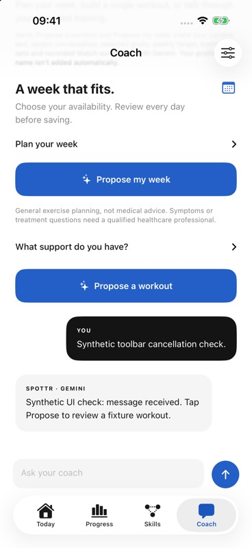

# Coach loading toolbar: bounded simulator check

25 October 2026, 04:33–04:37 UTC. The root task supplied the installed phone build containing PR #112 (`bec7dcc`). UI actions used CUA on the existing Musalli-Test simulator, isolated namespace `BBE22E52-B303-4BBD-A2F1-EA30512F025C`.

A private loopback fixture on `127.0.0.1:8846` accepted exactly one explicit synthetic chat request at 04:33:26 UTC and completed its response at 04:33:36 UTC. Its injected-scheduler test first failed for the missing wrapper, then passed 1/1 without real waiting. The wrapper imports the existing typed fixture, has no external fetch, records no headers, permits one request, and expires after two minutes. The process exited after its single response; port 8846 was then confirmed closed.

## Actual UI observation

The composer contained **Synthetic toolbar cancellation check.** before the explicit Send tap. While the fixture was delaying, CUA showed an indeterminate toolbar spinner, **Waiting for your coach…**, and a visible toolbar **Cancel** action. Send cleared the composer and retained the exact text as the user turn. The returned text explicitly identified itself as a synthetic UI fixture. No approval, saved-plan action, workout start or history save occurred.

The tool roundtrip completed after the 10-second response window before Cancel was tapped. Explicit UI cancellation, suppression of a late response after cancellation, and loading with the weekly panel fully offscreen were **not exercised**. These are not claimed failures. Hardware keyboard entry was used; visible software-keyboard dismissal was not re-tested here. The separate native keyboard behavior test is recorded in [coaching-ui.md](../coaching-ui.md).

Screenshot SHA-256: `7e07f92b419bcdef5a5d76f21b61c720b4c5e122ac7183ecda52ef48bd1fdcf3`.

The in-flight state was observed in the CUA transcript; the durable screenshot above was captured after completion. It is an unchanged 368 × 800 MCP JPEG from phone simulator `BF27AFBA-FF1E-4484-A3BD-42916CEB1170`.

## Restoration and limits

The original gateway URL, `http://127.0.0.1:8788`, was restored through Coach settings. The entire preferences plist was byte-for-byte identical to the private baseline afterward. Namespace `history.json` and `profile.json` hashes also matched, with no new JSON files. The populated secure token field was never edited; Keychain values were not extracted or independently compared.

Capture Keyboard was restored off and DeviceHub returned to TinyTaps-Watch before releasing the UI lane. The task Chrome mirror tab was closed and viewport reset; localhost zoom remained 90% rather than its original 25%, a reported cleanup limitation. Safari and the existing Vultr tab were not operated.

There was **one local fixture request and zero external provider calls**. This check demonstrates the rendered generic chat loading status, not Gemini availability, weekly-planning quality, physical-device behavior or new cancellation evidence. Private request/response, fixture test logs and before/after comparisons remain under `.local/app-gaps-coach-ui/acceptance-loading-20261025/`.
