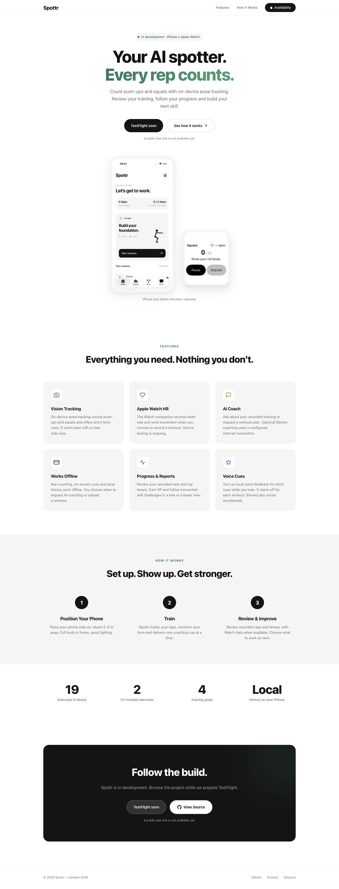
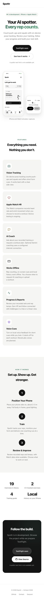

# Local landing browser acceptance

24 October 2026. These are two separate checks of two source revisions, served only from `landing/` on a task-owned loopback server. No deployment or provider call occurred.

## Current white native-screen revision — 23:32–23:33 UTC

Checked source: `landing/index.html`, SHA-256 `2de4622565aeffbe999a6b99c9aae830179c56173a128d1ba64c917ffa0541e7`. This focused follow-up used CUA/Chrome for all browser interaction, DOM inspection, reduced-motion emulation and final captures. Safari and unrelated services were preserved.

| Check | Observed result |
| --- | --- |
| Responsive layout | Desktop 1440×1000, tablet 768×1024, mobile previews 390×844 and 320×800 had matching document/viewport widths and no overflowing visible element bounds. The two simulator images retained their aspect ratios without observed cropping. |
| Actual screen content | Exactly two displayed images: the white iPhone Today and Watch simulator captures. The Watch shows no heart-rate reading. The caption is “iPhone and Watch simulator captures.” No second concept phone, invented 142 BPM/8 reps display, design-preview text or How It Works concept images remain on the page. |
| Assets and logs | The page and both JPG assets returned HTTP 200 in the isolated server log. Both images loaded with nonzero natural dimensions and descriptive alternative text. CUA's tab log reported zero console warnings/errors. The document contains no scripts. |
| Keyboard and anchors | Skip to content received visible green 3px focus and activated the main landmark; the next Tab reached See how it works, skipping disabled TestFlight. Its keyboard activation reached `#how`, below the fixed navigation (about 88px versus 65px). The same mobile link worked at 390px. View Source, GitHub, OxHack and Devpost were keyboard reachable with visible focus. Availability navigation worked. |
| Reduced motion | With reduced motion emulated, the page reported `scroll-behavior: auto` and a checked hero-link transition duration of `0s`. The temporary override was reset afterward. |
| CTA contracts | All internal anchor targets existed. Both TestFlight buttons were disabled and described as unavailable. View Source/GitHub pointed to this repository; OxHack and Devpost pointed to their event sites. External links used `noopener noreferrer`; they were not opened. |

The checked assets are `today-simulator.jpg` (368×800, SHA-256 `a11c4ae13abc57ece185b9694e6b23fe4b3385d40cfb8a2d6a30c8daa639fef3`) and `watch-simulator.jpg` (671×800, SHA-256 `b4a6a8d6ce78ab43ef6dbb791d8af4d7f4fa2fedb7abcffa82a4f3fa473bec88`). They are simulator captures, not physical-device or live-sensor evidence.

No concrete regression was found in this bounded pass. Only the task-created Chrome tab and local server were closed; the temporary viewport override was reset. No landing source or asset changes were made by the acceptance pass.

## Earlier revision — 23:14–23:19 UTC

The earlier source SHA-256 was `f4b57fa482bbf628a2dd8cfea296b85524cce261c77a6e58ffd5bb7ee66e7e7b` (repository HEAD at that check's completion: `761307a`). It still displayed five design-preview PNGs. Dedicated MCP Playwright browser tools checked the same four viewport sizes, image loads, keyboard/focus, section navigation, external href attributes and reduced motion. The page plus five assets returned HTTP 200; observed resources were local only and console warnings/errors were zero. CUA/Chrome supplied its final screenshots. Those earlier captures are superseded by the white native-screen captures below; the earlier results do not establish acceptance of the revised image content.

## Limits and public screenshot receipts

This is local desktop-browser and emulated-viewport acceptance, not physical iPhone/Safari, touchscreen, screen-reader, deployed-hosting or comprehensive accessibility acceptance. External destination reachability was not tested. The external TestFlight invitation was still pending Apple beta review at this checkpoint; this page review did not query App Store Connect or establish public installability. See the current [installation guide](../testflight.md) for release status. No camera/microphone access, voice playback, provider calls, publication or deployment occurred.

Both new CUA full-page captures were visually inspected before copying unchanged. They contain page content only, with no browser chrome, account details, private contacts or unrelated windows. CUA returned JPEG bytes; the public copies use matching `.jpg` extensions without conversion. Times are UTC; image heights include the whole page, rather than just the emulated viewport.

| File | Capture time | Full-page dimensions | SHA-256 |
| --- | --- | --- | --- |
| `landing-browser-2026-10-24-desktop.jpg` | 23:32:47 | 1440×3772 | `b8cfe3b349e57be070c3f14a6be1228d53d11797c7b3c60bf50ef32ed8789265` |
| `landing-browser-2026-10-24-mobile.jpg` | 23:32:50 | 390×5256 | `390b0e527d856dd6a8dd809e7c813d343c5ec40b646720026b653bcc2ee977af` |

