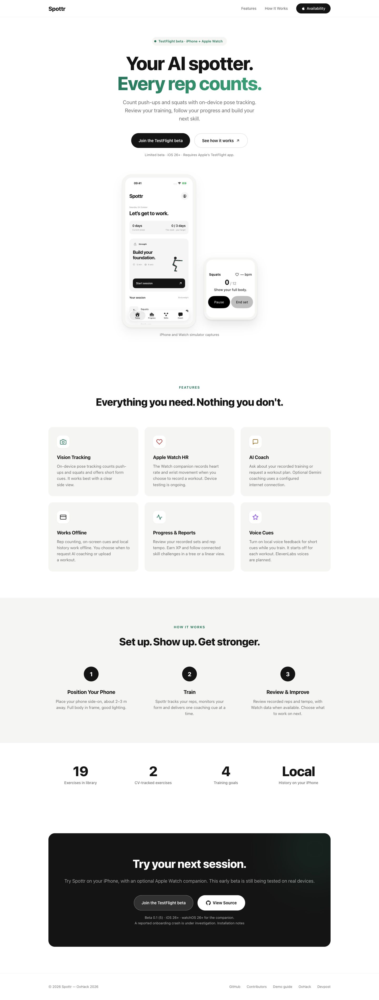
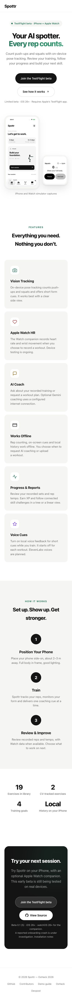

# Landing publication — 25 October 2026

Published the existing white Spottr page at [spottr.omarchoudhry.co.uk](https://spottr.omarchoudhry.co.uk/) on the already approved Vultr VM `04331310-56ac-4b8d-b1ef-f17e946404fb`, `95.179.235.236`. HTTP/hash checkpoint: **07:22:39 UTC**; hosted browser check/captures: approximately **07:23 UTC**. No new infrastructure or paid provider request was created. The existing **26 October 2026, 06:47 UTC** teardown target and $1 infrastructure ceiling still apply; this receipt does not extend them or establish a current account bill.

## Change

Reused the merged design, green accent, system fonts and unchanged raster iPhone/Watch simulator captures. Added links to the existing contributor and demo documentation, minimum OS versions and the current documented build **0.1 (5)**. The reported onboarding crash is identified as under investigation. Both beta actions retain `https://testflight.apple.com/join/f3MhePbf`. Feature claims exclude the later energy/voice/Presage work. The page does not claim physical sensor acceptance or exercise accuracy.

Caddy now serves only `/` and `/assets/*` from a read-only static root. All other paths retain the existing remote-IP allowlist and gateway behavior. Gateway authentication, request-size/time limits, no-retry policy, health handling, private env files, image and network isolation were preserved. There is no SPA fallback or repository-root mount. Only `index.html` and the two referenced JPGs were copied to the production static root.

## Verification

| Check | Actual result |
| --- | --- |
| Test-first static contracts | Before edits, two of three tests failed for missing release limits and contributor/demo destinations. After edits, **3/3 pass** with `python3 -m unittest discover -s landing -p 'test_*.py'`. |
| Test-first routing | The pinned Caddy container initially returned **404** for `/`, reproducing the publication gap. The revised configuration passes `deploy/tests/landing-routing.py` for both allowed and excluded client configurations, using an isolated loopback listener on the existing VM/network. |
| Allowed route checks | `/health` **200**; missing-bearer POST `/v1/chat`, `/v1/summary`, `/v1/proposal`, `/v1/week-proposal`, `/v1/workouts` **401**. The deployed older gateway returns **404** for optional voice routes. Unknown/query-suffixed routes and secret-like paths retain gateway **404**, without serving landing HTML. No authenticated provider request is made. |
| Outside route checks | Isolated Caddy check returns **403** for health and every nonstatic probe, including a forged `X-Forwarded-For`. A separate real HTTPS check from the VM's nonallowlisted egress returns public root/image **200**, health/chat **403**. |
| Public HTTPS and hashes | Mac default trusted-TLS client received **200** for root and both assets; all three bytestrings match this PR's sources. Mac allowed health **200**, missing-bearer chat **401**, `/.env` and `/deploy/gateway.env` **404**, missing asset **404**. |
| Runtime preservation | Production Compose validation and Caddy validation passed. Only Caddy was recreated. Gateway container ID and private `gateway.env`/`deployment.env` SHA-256 values matched before/after; values remain private. Persistent Caddy certificate volumes were retained. External ports **8787** and **2019** were unreachable from the Mac. |
| Hosted browser | Separate Playwright/Chromium tab loaded the correct title and complete page. **320, 390, 768, 1440 px** viewports had document width equal to viewport width, no overflowing visible element bounds and both captures loaded. No console warnings/errors or error overlay. Only the page and two same-origin JPG requests were observed. |
| TestFlight destination | A separate browser tab opened the existing Apple invitation with the correct Spottr title and **View in TestFlight** action. No invitation was accepted, deep link opened or app installed; Apple distribution/build state was not requeried. |
| Keyboard and motion | Tab reached **Skip to content** with a visible **3px** outline; Enter focused `main`. Keyboard activation of **See how it works** reached `#how`, **87.98px** below the viewport top. Contributors link had visible **3px** focus. Reduced-motion emulation reported `scroll-behavior: auto` and `0s` link transitions. |
| Screenshots | Hosted full-page desktop **1440×3793** and mobile **390×5384** captures below were visually inspected. Existing layout/images are retained; expanded footer wraps without clipping. |

Browser plugin/skill was unavailable, so the dedicated Playwright tools were used. Safari, shared simulators and the native build queue were untouched. The external web-fetch tool could not access the landing or Apple invitation; that tool's failure is not a hosting result. The hosted HTTP and browser checks above used the actual public hostname.

## Public byte receipts

| File | SHA-256 |
| --- | --- |
| `landing/index.html` | `be3673afb0c5e01dbfc1c596e2c6899f7ed8173017547c2da428e309f4e99e39` |
| `assets/today-simulator.jpg` | `a11c4ae13abc57ece185b9694e6b23fe4b3385d40cfb8a2d6a30c8daa639fef3` |
| `assets/watch-simulator.jpg` | `b4a6a8d6ce78ab43ef6dbb791d8af4d7f4fa2fedb7abcffa82a4f3fa473bec88` |
| `landing-published-2026-10-25-desktop.jpg` | `3d2bfd8918d3730ae5dacbff1832a10aad1251dfd26335049293d436768a653c` |
| `landing-published-2026-10-25-mobile.jpg` | `6fa09d9a7e26e9206b0115ddfaf2059f2a10c2e98c5b16a6d5d6ee391b85f819` |

## Restoration and remaining gates

The exact production source directory remains `/opt/spottr/source-4eebd6d`. Only its `deploy/Caddyfile`, the single read-only landing mount in `deploy/compose.yaml`, and the new `landing/` directory changed. Original Caddyfile/Compose copies and private hash/container-ID receipts are retained in root-only `/opt/spottr/landing-publication-20261025/`. To restore the former fully restricted root, restore those two config copies, validate Compose/Caddy, then recreate **only Caddy** with the existing private env file and `up -d --no-deps --no-build caddy`. Do not restart/rebuild the gateway or remove certificate volumes. The isolated routing-check container was removed after every run.

Merge and any next TestFlight upload remain with the primary chat. Physical iPhone/Safari, touchscreen, screen-reader, app installation, actual workout/sensor acceptance and the build-5 crash fix remain unverified by this publication. Existing beta distribution evidence is linked from the [installation guide](../testflight.md); publication does not certify native behavior or newly integrated provider paths. The demo guide is written documentation, not a claimed recorded demo video.

