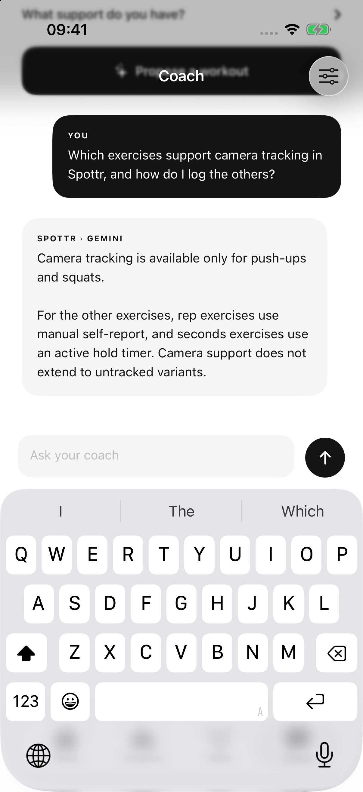

# Native Gemini chat checkpoint

24 October 2026. The existing Musalli-Test simulator ran an ad-hoc-signed current Spottr build (`build_sim_2026-10-24T21-20-32…8fa1267f`). An isolated UUID data namespace supplied no recorded workout or physical sensor history. The gateway URL and separate gateway token were saved through Coach settings; the provider key stayed on the server. An earlier unsigned simulator install could not save the credentials; signing guidance is in [setup](../SETUP.md).

One explicit Send asked: “Which exercises can you track with the camera?” The local gateway on port 8788 used the configured real Gemini endpoint. The app displayed:

> I am Spottr, your exercise coach. The supplied facts do not list which specific exercises can be tracked with the camera.

This establishes native configuration, authenticated networking and response rendering for this one chat. Its abstention exposed missing product-capability context; the separate server improvement is tested offline and this response does not validate that revised prompt. No automatic retry, voice generation, personal biometric capture or real-user coaching assessment was performed. Native proposal/report and physical phone acceptance remain separate.

## Revised capability context — 22:44–22:45 UTC

A second, single explicit Send exercised the server-owned capability context added in PR #50. The existing signed Musalli-Test app used fresh namespace `64DDC344-10A4-46E4-96AF-9E4D6FBB9A7E`, with no recorded training or sensor history and no profile. The saved gateway URL remained `http://127.0.0.1:8788`; the existing Keychain token was reused. No configuration, approved plan or default profile was changed.

Question: “Which exercises support camera tracking in Spottr, and how do I log the others?”

The native Coach displayed this real Gemini reply:

> Camera tracking is available only for push-ups and squats.
>
> For the other exercises, rep exercises use manual self-report, and seconds exercises use an active hold timer. Camera support does not extend to untracked variants.

This matches the current catalogue's base push-up/squat camera flags and manual/timed input rules. It accepts the revised prompt's product-capability behavior for this question; it does not establish personal coaching quality or proposal/report correctness. One Send was performed, with no manual retry. Provider token/billing counters and precise latency were not captured. No fake provider, voice synthesis, real sensor data or physical phone was used in this check.

The Device Hub screenshot shows the actual question and reply, captured at 22:45:09 UTC. SHA-256: `e3a278678be80ddbba6c3e362178940063581e64c4849e4e0d01b57af080425c`.

Afterward, the app was stopped and relaunched without the test namespace; its original onboarding screen returned. Keyboard capture was restored to off. The local gateway was preserved. Physical HTTPS networking, live native proposals/session/week reports and real-user factual review remain pending.
