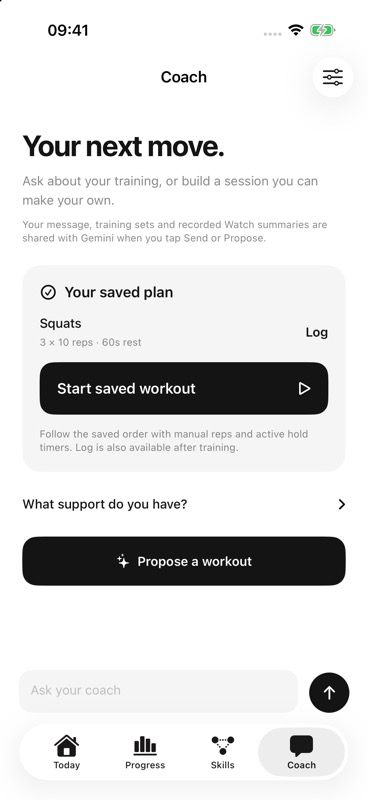
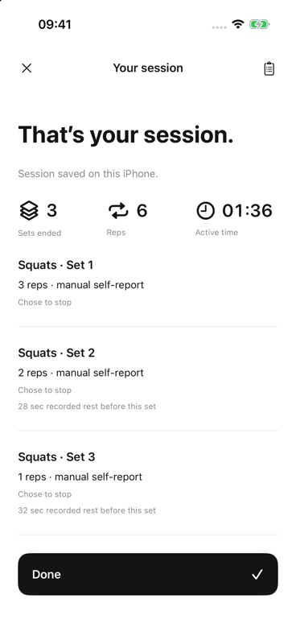

# Native Gemini proposal → approved plan → saved session

25 October 2026, approximately **00:47–00:56 UTC**. This closes a specific synthetic native-flow gate left open by the [earlier proposal/report check](gemini-structured-compatibility-2026-10-25.md). It is not physical exercise, sensor, speech or coaching-quality validation.

## One bounded real request

The existing signed Musalli-Test app ran in fresh data namespace `D54557A5-FD38-4D91-97FC-B934FF35349A`, with no profile, recorded workouts or sensor history. Its existing Keychain token was reused. For this check only, Coach settings pointed to a task-owned **loopback** gateway on port 8843 with Tiger disabled, one shared generation attempt and a 30-minute absolute expiry. No public tunnel was started. Existing services on 8787/8788 were preserved.

One explicit **Propose a workout** tap at **00:49:05.679 UTC** returned a real `gemini-3.5-flash-lite` proposal: Squats 3 × 10, Push-ups 3 × 8 and Forearm plank 3 × 30 seconds, each with a 60-second rest target. The rationale correctly referred to zero saved sessions. All toggles initially appeared off. Squats alone was selected, then **Approve & save selected exercises** was activated.

The actual persisted plan contains only `squat`, three sets, target 10 reps and rest target 60 seconds. Its JSON SHA-256 is `51730a1197f8f1cd9bf393b4fa94c9bc0359cfa5bd9168a4740df5ce913ae382`. Full local schema/semantic validation remained active. Exact model token usage, billing and latency were not captured.

## Actual app execution and persistence

**Start saved workout** opened Squats set 1 of 3 with manual input and an empty actual count. Each set was explicitly started, given a synthetic manual count, and explicitly ended. Intermediate **Ready for next set** actions returned to preparation; targets and rest timers did not start or finish sets automatically. No camera, Watch recording, speech or reserve estimate was used.

| Set | Target | Entered reps | Recorded active seconds | Recorded rest before |
| --- | --- | --- | --- | --- |
| 1 | 10 | 3 | 43.766618 | absent |
| 2 | 10 | 2 | 31.282699 | 28.537622 s |
| 3 | 10 | 1 | 21.758107 | 32.003945 s |

The final **Review session** action saved one record, ID `BAF55A21-6638-4C8C-9A1C-773F2408AEDC`. Its on-screen review showed **3 sets, 6 reps, 01:36 active time**, with all three manual source labels and 28/32 seconds of recorded rest. Disk inspection confirmed the ordered `loggedSets`, `source: manual`, `quantityOrigin: selfReport`, unchanged targets and no telemetry or legacy camera sets. Total recorded active time is **96.807424 seconds**. The saved history SHA-256 is `9bb94ff580e5dd01b11a6e3aea17fc3cd4daad7c0689485d23fd8e9055a68a98`.

At **00:54:17.952 UTC**, a subsequent valid authenticated chat request returned **429 `demo_budget_exhausted`** before a provider request. The temporary process was then stopped. This live check exercised the one-attempt guard; the wider [offline guard tests](../../integrations/gateway/OWNER-DEMO.md) cover concurrency, errors, expiry and slow reads.

## Cleanup and artifact scope

After stopping the app, the isolated history was hash-checked and moved into ignored private evidence. Only the newly saved plan key was removed and the gateway URL restored to 8788 using the exact app-container preference domain. An initial bundle-ID-only defaults command addressed no matching domain and made no change. At **00:56:16 UTC**, the full preference dictionary matched its pretest backup; the approved-plan key was absent and isolated history removed. Normal launch showed the original onboarding, and keyboard capture was restored to off. The Keychain token, original data and existing simulators were preserved.

This was the installed Debug **0.1 (1)** app, with executable SHA-256 `7cc4fba7956d242fea8e80321e0fc6646d84fe1194806a44cf5248d2cede9a02` and Debug dylib SHA-256 `b8b90154c4503940e3cacb6ca8d447ae279fb1bc2c0229576d6f92911bab5eb2`. The executable matches the earlier structured-response check. It is not an installation of the separately approved TestFlight build 3. Private setup, plan, history and cleanup receipts remain under ignored `.local/native-live-plan-20261025/`.

Both unchanged JPEG captures are 368 × 800 pixels, contain only the synthetic app flow, and were visually inspected:

| Image | Bytes | SHA-256 |
| --- | --- | --- |
| `native-gemini-approved-plan-2026-10-25.jpg` | 43,110 | `8dcb83001c2f4f5bd9b78d90bcb9486ce07b66d26565a4fdbea62dd8625619bb` |
| `native-gemini-completed-plan-2026-10-25.jpg` | 37,168 | `9d2fc4875795b70adc2ef8fee9129d8e4149ec403e124bb07be2a276d1fde967` |

