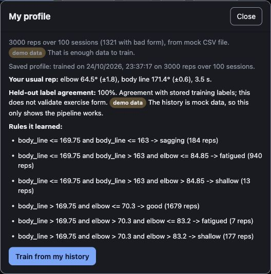

# Push-up prototype integrity checkpoint — 24 October 2026

Scope: corrective work after teammate PR #59 (`10c5e6b`, merged as `12a7d99`). This is the standalone browser prototype, not a replacement for native Spottr or evidence of detector accuracy.

## Verified offline

- Full `npm test` in `prototype/pushup`: **92 passed, 0 failed**, about 1.95 seconds. The original head returned 41 passed / 4 failed because the HTTP test fixture omitted new imports.
- Final profile-copy adjustment: all **26 client regressions passed** again. Module syntax and whitespace checks passed. Independent agents reviewed server, profile, database and browser wiring; identified findings were corrected before integration.
- Fresh replay/camera/reset provenance; actual completion timestamps; immutable first-finish snapshot; default rule until explicit personal selection; one frozen rule through pause/resume.
- Explicit uploads, a durable owner-bound outbox before identity/transport requests, manual retries, terminal conflicts, and stale-response guards. Stop cancels camera startup through pending video playback.
- Same-origin local session authorization; strict JSON/owner/source/variation validation; mandatory verified TLS; atomic receipt/rep transaction behavior using a fake database boundary.
- Shared CLI/HTTP readiness and row validation; valid good baselines; missing-duration disclosure; old artifact preservation; immutable owner/source/mock provenance and UUID-grouped held-out sessions.

These checks used synthetic fixtures, temporary profile files and fake provider/database boundaries. No external model-generation requests or database writes were made.

## Browser acceptance

An isolated local server on port 8842 had Gemini and Tiger disabled. In the Codex in-app browser:

1. The official MediaPipe full model loaded and the page displayed **Model ready**.
2. **My profile → Train from my history** completed on the bundled 3,000 mock reps / 100 sessions and saved finite baselines.
3. Reload retained the profile and demo-data label. Default rule remained selected; explicitly choosing the personal rule showed its tightened limits and demo-data provenance. Selection was restored to default.
4. The final panel says **Held-out label agreement**, with an explicit distinction from form validation.

No camera capture, physical iPhone/Watch, real exercise clip, live cloud upload, or detector-accuracy check occurred in this smoke test. The test server was stopped afterward; the normal native gateway on port 8788 was preserved.

Model downloaded by the existing `npm run setup` script, SHA-256 `4eaa5eb7a98365221087693fcc286334cf0858e2eb6e15b506aa4a7ecdcec4ad`. The model stays ignored rather than being committed. Screenshot SHA-256 `50d2f9c97c3373ba7a2869ebba7c020b3e6aa8aea3b396fa8b8be3ed4e5b1415`; cropped to the mock-profile dialog to exclude the local phone-control code.

## Remaining acceptance

Apply migration `004_immutable_workouts.sql` only after verified Tiger connectivity is available. Real DDL/transaction/continuous-aggregate acceptance is still pending; the configured endpoint failed strict certificate-chain verification in the latest bounded check. No certificate bypass or new CA trust was used. The older aggregate groups by integer start-second session and may combine same-second workouts, while profile fitting uses UUID groups. Legacy natural-key collisions fail conservatively rather than overwriting rows.

This work does not validate physiological predictions, form labels or learned capacity. Native app and TestFlight acceptance remain separately recorded in the main release handoff.
