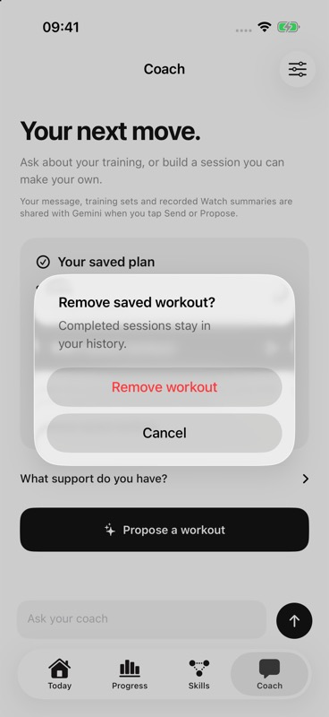
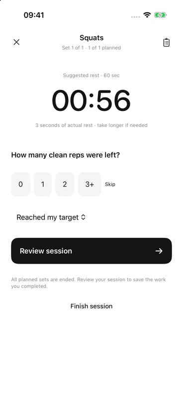

# Saved-workout removal and final-set guidance

25 October 2026, **01:00–01:12 UTC**. The Coach card now offers **Remove saved workout**, with Cancel and a confirmation that completed sessions stay in history. Removing a plan clears only its saved key and in-memory card. In-flight chat, proposal and report responses remain usable; only explicit approval can save a replacement. Final recovery now says **Review session** and explains that reviewing saves ended work. Intermediate recovery retains the explicit Start guidance.

## Verification

Focused `CoachFlowTests` and `ConfiguredWorkoutFlowTests` finished **16/16 passing** after a runtime RED result of 15/16 for the old final-set copy. Tests use isolated defaults and verify narrow plan removal/reload, preservation of history/profile/settings, continuation of all three in-flight request types, replacement approval, and intermediate/final save transitions. No provider calls were used. The final signed Debug build/run succeeded in **15.750 seconds**; its actual log contains two AppIntents metadata-extraction warnings, with no build errors. A separate agent reviewed all three production files and both test files with no material findings.

On existing **Musalli-Test**, a fresh owned namespace was seeded with a synthetic saved plan and one synthetic completed record. Cancel preserved the persisted plan and history hashes. Confirmation removed the plan/card while the full remaining preference dictionary equalled the pretest backup and the history hash remained unchanged. A separate in-memory one-set Squats fixture was explicitly started, given one actual rep and ended. Its recovery screen showed the new final guidance and **Review session**. No review/save action was taken for that fixture.

The app was stopped; the owned synthetic history was hash-checked and recovered into ignored private evidence. Original preferences matched the complete backup. Normal launch showed original onboarding, keyboard capture was off, and Keychain/original records/simulators were preserved. No provider, camera, Watch or speech request was made. Private receipts: ignored `.local/native-plan-removal-20261025/`.

Build log: `build_run_sim_2026-10-25T01-04-25-193Z_pid4129_49726a7f.log`; green test log: `test_sim_2026-10-25T01-01-13-806Z_pid15618_befa5df8`. This is a local Debug acceptance, **not TestFlight build 3** or physical-device acceptance.

Both unchanged 368 × 800 JPEGs contain only synthetic app data and were visually inspected:

| Image | Bytes | SHA-256 |
| --- | --- | --- |
| `remove-saved-workout-2026-10-25.jpg` | 43,893 | `17ec748498b23f3f627152bcfd15291ae3d675b1c0f2bf6e18fae441cdc08433` |
| `final-set-guidance-2026-10-25.jpg` | 28,959 | `0bbd77572931552ae8ec960ff62dbf707deb16970ec3e7c397468d8813e3b15f` |

