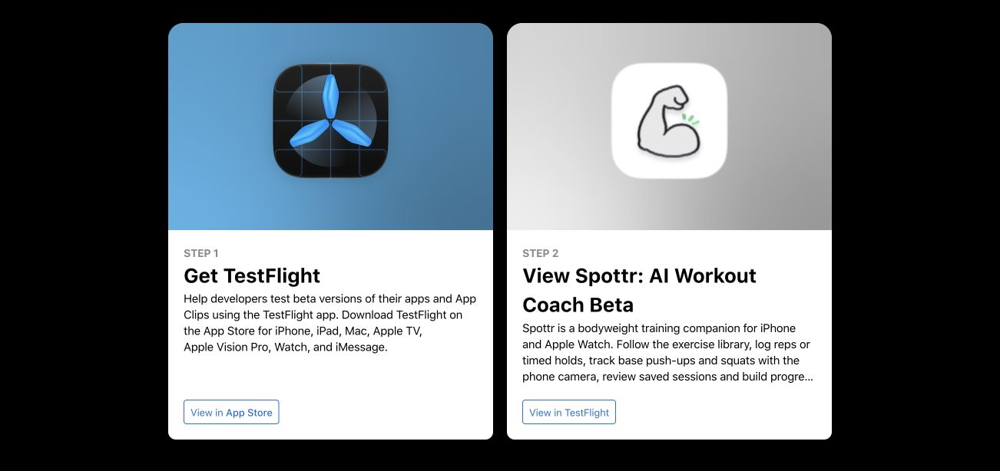
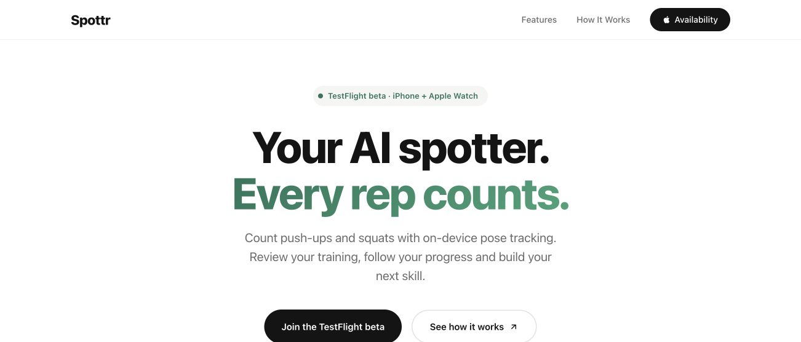

# Public beta invitation and landing availability

25 October 2026, approximately 00:28–00:34 UTC. Apple reported external build **0.1 (1)** as `IN_BETA_TESTING`. The OxHack external group read-back contained only build 1; the public invitation was enabled with a 25-person limit. Builds 2 and 3 remain separate internal updates. See the [build 3 receipt](testflight-build-3-2026-10-25.md) for artifact and distribution evidence.

CUA/Chrome opened the [public Apple invitation](https://testflight.apple.com/join/f3MhePbf). It visibly displayed **Get TestFlight**, **View Spottr: AI Workout Coach Beta** and **View in TestFlight**, without a closed-beta message. No `itms-beta` link was launched, invitation accepted or app installed. This is public-page availability, not acceptance on a physical iPhone or Watch.

Before the landing edit, the local page exposed two disabled **TestFlight soon** controls and stated that no public link was available. After replacing these with ordinary HTTPS links, the hero link activated with Return and reached the public Apple invitation. Browser Back restored the landing page; clicking the footer link reached the same Apple page. Both links expose the same destination and accessible name. The beta badge, availability text and footer copy were updated; no artwork, SVG, layout or provider behavior was added.

The local page and two simulator JPEG assets returned HTTP 200. The current hero was visually inspected at the existing desktop viewport. The previous [four-width layout and reduced-motion acceptance](landing-browser-2026-10-24.md) describes its own earlier source revision; no new mobile, Safari, touchscreen or screen-reader acceptance is claimed for this link-only update. The landing site has not been deployed. Task-created tabs and the loopback server were closed.

Checked `landing/index.html`: SHA-256 `2aa7251d77715399ee1f6ff6c365e76128925bd8b69ae37c28b82e4517b95bb3`.

| Page-only screenshot | Dimensions | Bytes | SHA-256 |
| --- | --- | --- | --- |
| `testflight-public-invitation-2026-10-25.jpg` | 1302 × 614 | 60,799 | `6962eafd992792f7e1e63ac038dc81655be12b018cdb9975e24d26c13003aaee` |
| `landing-testflight-2026-10-25.jpg` | 1302 × 614 | 42,512 | `9853bae7352cb010d994c715a2fd8c0b74e71e33076160d77002da715a517a24` |

The images were saved unchanged from CUA JPEG bytes. They contain no account credentials or unrelated windows. The external-review heartbeat was paused through the automation tool after this meaningful review outcome was handled; the broader MVP work continues.

