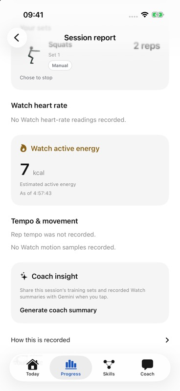

# Local Watch active energy — 25 October 2026

This checkpoint covers the **local active-energy source addition**, not TestFlight build 5. It verifies local typed data handling, SDK-double lifecycle behavior, builds and a synthetic phone report. It does not verify physical HealthKit capture or estimate accuracy.

## Implemented behavior

`ActiveEnergy` retains recording UUID, cumulative kilocalories and `asOf`. Session ingestion rejects invalid/future/prior-session timing. The Watch store retains the latest observed timestamp; reports choose the latest cumulative observation per recording, resolving equal-time corrections by envelope time. Repeated values are not added, and downward/zero revisions are retained. Multiple recordings remain separate.

Old history decodes without the optional field; local history and export preserve it. Strict v1 sync omits energy and appended energy-only packets while retaining legacy empty envelopes and mixed HR/motion bytes. Coach grounding and outgoing requests are unchanged. Energy appears on the **phone report only**; compact Watch metrics are unchanged. No cloud-energy v2 route or Tiger migration was added.

## Actual checks

- Core: full isolated SwiftPM suite, `--jobs 2`, **68 XCTest + 122 Swift Testing**, zero failures/warnings. Private receipt: `energy-core-final-full-receipt.json`; log SHA-256 `c51cc0a1e30585066062166bd4807e745d6e2cda4f2e4322027146b23b33ff14`.
- Projection RED: appended energy-only packets changed expected byte lengths from 187→275 and 559→648. The focused suite then passed **9/9** after the narrow filter, including preserved legacy empty/mixed envelopes and unchanged Coach requests.
- SDK-double ordering RED: an older callback replaced a newer cumulative observation and the next tick sent the stale value. GREEN: **10 recorder + 5 Watch-store** behavioral cases passed (`watch-energy-ordering-{red,green}.log`). These use SDK/link doubles, not real sensors.
- Watch simulator build at **05:05:39 UTC** passed with zero warnings. Generic watchOS device-SDK unsigned build also passed; its two known warnings were missing AccentColor and skipped App Intents metadata. This was compilation, not installation.
- Phone report UI RED at **05:00:59 UTC** failed the missing-energy assertion (`ReportFlowTests:33`). GREEN at **05:02:49 UTC** passed **1/1**, zero warnings. Root's actual CUA check subsequently showed synthetic cumulative readings **5, 5, 7** as **7 kcal once**, labelled “Estimated active energy” and “As of 4:57:43.” Missing HR/motion remained missing. The private fixture receipt records acceptance at **05:07:45 UTC**.

Screenshot SHA-256: `ac2ac4e29e776a1e96e10e77f034e2e1808b08425fea2dd795aabe4d84751703`. This is a synthetic simulator report, not measured calorie burn.

## Remaining acceptance

Explicit physical Watch permission/lifecycle checks, actual readable energy estimates and recording/save behavior remain pending. Authorization completion does not reveal a read grant; missing readings do not mean denied access or zero energy. No provider request, cloud persistence, public HTTPS deployment or physiological-quality acceptance follows from these checks. See [capture limits](../watch-telemetry.md) and [planned sensors/cloud versioning](../watch-sensor-roadmap.md).
