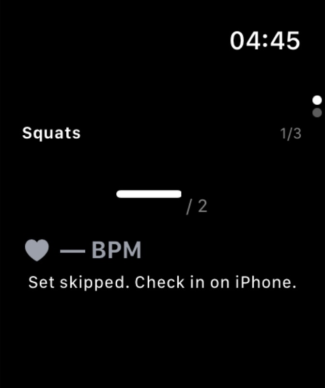
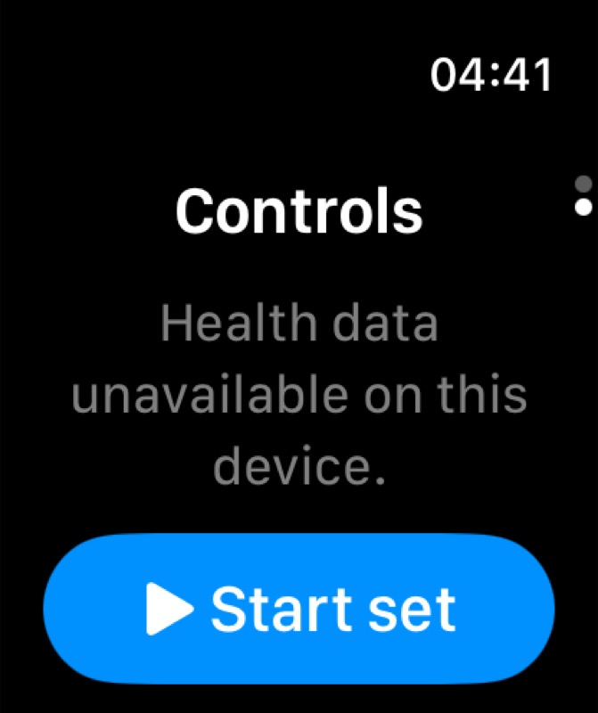
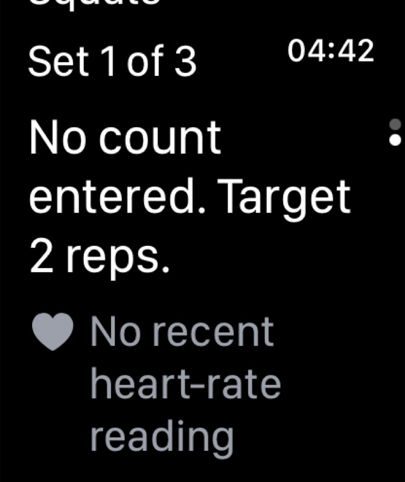
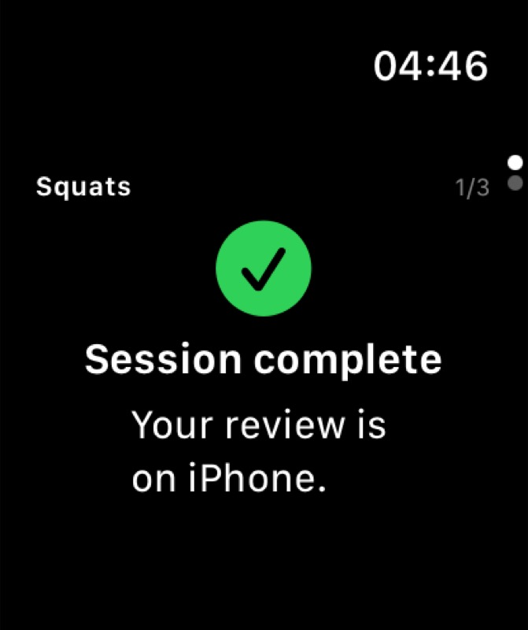

# Compact Watch navigation simulator receipt

Observed by root on 25 October 2026, approximately 04:29–04:46 UTC, using the existing paired simulators. This receipt records rendered simulator checks and root-reported build results; it is not physical Watch or sensor validation. The [navigation guide](../watch-navigation.md) records the preceding reproduced failure and bounded diagnosis.

## Observed checks

- The 04:29 candidate build passed without warnings. Two complete Ready Metrics → Controls → Metrics round trips used the original upward drag `[839,913]` → `[839,685]` and reverse drag `[834,700]` → `[834,940]`; both pages remained visible.
- Builds at 04:39/04:40 temporarily injected SwiftUI's largest `.accessibility5` text size. Metrics fitted the 159-point viewport; Controls exposed the full details and instruction through three scrolls: no count entered, target two reps, Set 1 of 3, and no recent HR. This was an environment override, not a physical-device accessibility-setting test. The override was removed before the 04:42 normal build.
- An actual tap initially left recording failure feedback offscreen. The compact Record action was then made to open Controls, with recording status at the top. The large-text check showed the full **Health data unavailable on this device.** message; no HR value was inserted. Recorder guards were unchanged.
- At 04:43, skipped Metrics omitted Record and Controls omitted Start/Next/Record. End session → Cancel retained the same check-in.
- A skipped-state check exposed a misleading idle recording instruction. After hiding it for skipped/discomfort states, the 04:44 normal build passed without warnings. Its skipped Metrics → Controls → Metrics round trip stayed readable, including a later capture after independent work; Controls showed skipped status and End session without the idle recording note.
- At 04:46, explicit Finish on iPhone produced a normal-text Watch page with the green completion mark, **Session complete** and **Your review is on iPhone.**, all within the viewport. The retained 1/3 header represents the session position; it does not claim that three sets were completed.

## Capture provenance and limits

The JPEGs below are unchanged copies of the root-supplied MCP captures. Their displayed clock readings are 04:45, 04:41, 04:42 and 04:46 respectively. The two large-text images precede removal of the temporary override; the skipped and finished images follow the final normal-text build. The details image captures one scroll position, not the entire scrollable page at once.

| File | Bytes | SHA-256 |
| --- | ---: | --- |
| `watch-compact-skip-2026-10-25.jpg` | 28,790 | `8c09d9990ee2121708041dddfae0b2725df3a2a451dc8f0cbb710efc9bdef1df` |
| `watch-compact-large-status-2026-10-25.jpg` | 47,419 | `8285b7a4610a839f9f1d788373e582e560533e125f0be0595d37008e4fdf9fc3` |
| `watch-compact-large-details-2026-10-25.jpg` | 60,363 | `d3664e56cbb981e8a07866b7b5250f7801a613721640cb0dc78e1cac24c0a59a` |
| `watch-compact-finished-2026-10-25.jpg` | 37,718 | `fac7ae2b9c101c53bff03d417b36f148d1142da77e3695892d116c8ddd3ce806` |

Physical Crown interaction, Ultra device fit, Health authorization, actual HR/motion and HealthKit recording/save remain separate gates under [#110](https://github.com/NakkiV7/oxhack-team/issues/110). No provider request, synthetic HR or telemetry-schema change was part of these checks. No temporary diagnostic overlay or text-size override is intended for release.
