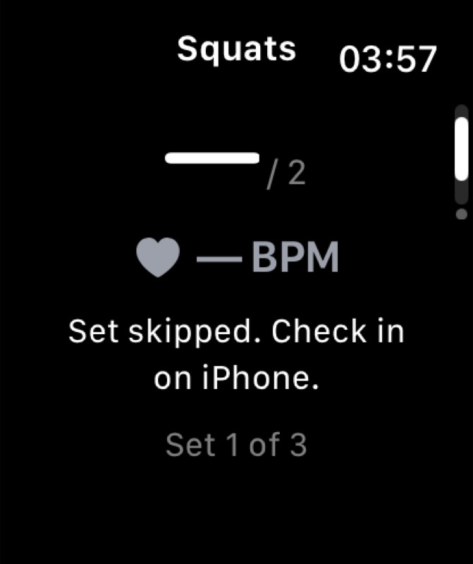

# Watch recording CTA and skipped-set UI check

Observed 25 October 2026, approximately 03:55–03:59 UTC, using the existing paired Musalli-Test iPhone and TinyTaps-Watch simulators. Root reported the Watch build/run succeeded at 03:49:13; this receipt records subsequent rendered UI checks, not a new build or physical-device test.

The phone used isolated namespace `BBE22E52-B303-4BBD-A2F1-EA30512F025C`. Catalogue Squats was prepared as manual reps, three sets with target two and zero suggested rest. No set was started and no rep quantity was entered.

## Observed

- Ready Watch Metrics showed a dash quantity against target two, gray **— BPM**, and a fully visible **Start Watch workout** button on a black background with black rounded corners.
- Explicitly tapping that button produced **Health data unavailable on this device.** on the Controls page. No heart-rate number appeared. A short upward drag made the complete status readable.
- Explicit **Skip set / stop here** on iPhone showed the supportive check-in with **Finish session** as the primary action. Watch Metrics received **Set skipped. Check in on iPhone.**, retained Set 1 of 3, and continued to show gray **— BPM**. The recording CTA was absent in this skipped state.

## Navigation observation and remaining checks

CUA upward drags could move content outside the visible Watch viewport, leaving only the clock/page indicator. This occurred before the phone skip and again from the readable skipped Metrics state. In the skipped state, drag `[839,913]` to `[839,685]` reproduced the blank viewport; a downward drag from the top edge, `[834,614]` to `[834,960]`, restored the same complete Metrics content. Short drags and wheel scrolling did not reliably navigate. DeviceHub accessibility exposed host controls but no app page or phase, so the exact nested-scroll/page state was not identified.

This is a bounded simulator navigation finding, not a confirmed source-level cause. Root subsequently reached Controls, verified **Next set** was absent, opened **End session**, and tapped **Cancel**. Controls retained the same skipped-set check-in. The phone then explicitly finished that isolated skipped route: the review showed zero sets, zero reps, zero active time, and one skipped step. This created a third synthetic check-in record in the same isolated namespace; normal history was untouched. The navigation gap remains tracked in [#110](https://github.com/NakkiV7/oxhack-team/issues/110).

No physical Crown behavior, Health authorization, sensor freshness, workout recording/save, camera, voice, or provider path was exercised. No synthetic heart rate was inserted. No app source, gateway/profile preferences, token, or normal history was changed. Skills presentation mode was changed from Grid to Linear for catalogue navigation; preview remained off. Grid restoration is pending after root finishes this retained diagnostic route. Capture Keyboard remained off; Chrome/Safari were untouched, and the MCP screenshot profile was restored to `spottr-phone`.

## Capture provenance

Both images are unchanged MCP JPEG captures from Watch simulator `4AF21271-32D7-42FF-A87B-CF3031C2FC00`, 671 × 800 pixels. The active `spottr-watch` screenshot profile was verified before capture; the earlier phone-only capture remains private and is excluded.

| File | SHA-256 |
| --- | --- |
| `watch-skipped-metrics-2026-10-25.jpg` | `f855e327660edbb0f597c121a24c37af55142f7a59da85ef5e03dada22604293` |
| `watch-navigation-blank-2026-10-25.jpg` | `233661ef8099f385673e684e3c1277d4c748e8d354484f97bd04f36761b37dd8` |

Root follow-up: changing the pager to horizontal pages and then testing based-on-size scroll bounce did not reliably resolve the blank viewport; both experiments were reverted. Build success alone is not navigation acceptance. A diagnostic-only overlay is being investigated separately and must not ship.

Diagnostic follow-up (04:11–04:25 UTC): removing the outer timeline did not prevent the reverse-page partial blank state. Removing the pager temporarily showed a transient overscroll that later settled with no additional gesture. Restoring the unchanged production pager reproduced a mostly blank Metrics page after the reverse drag; a later capture still showed only the exercise title near the bottom. Thus neither a permanent empty-content bug nor a timeline cause is established. All temporary overlays and layout experiments were removed; the original Watch source built successfully again at 04:24 UTC. Issue #110 remains open for paging/scroll presentation and physical Crown verification.
