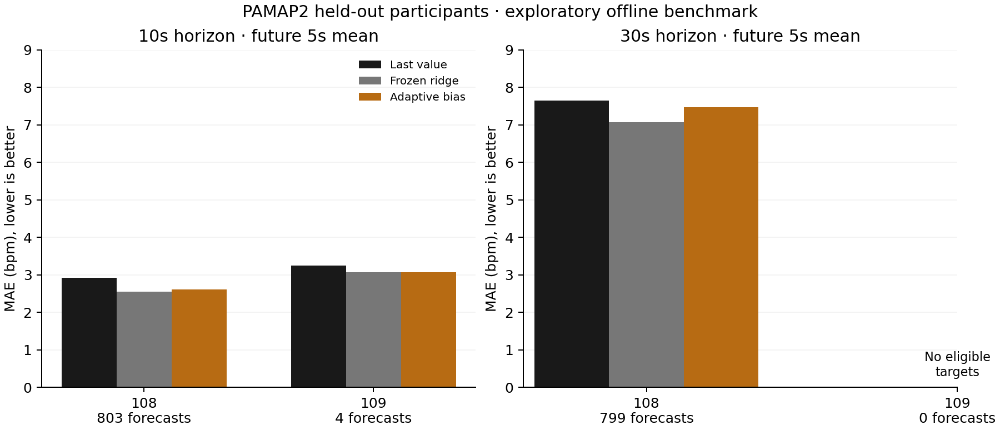
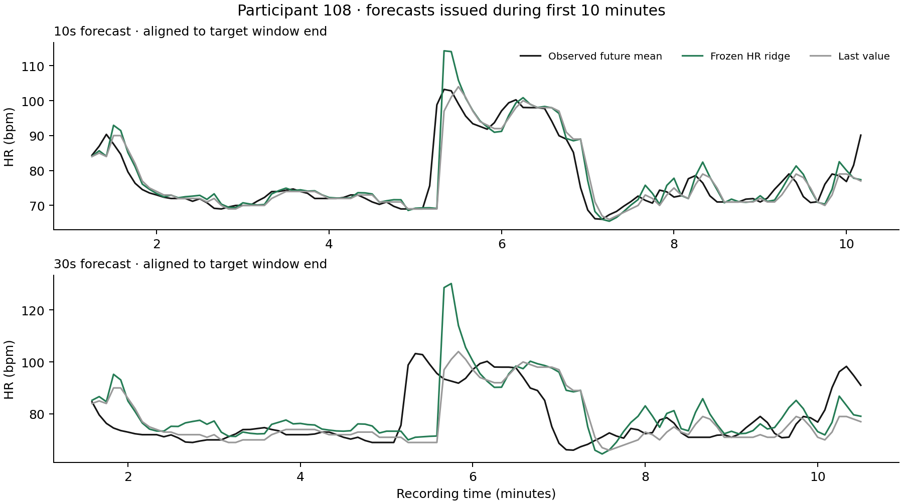

# Recorded PAMAP2 benchmark

Run: 2026-10-24T20:43:51.302260+00:00 to 2026-10-24T20:43:59.908274+00:00.

Frozen split: train 101–105, validation 106–107, test 108–109. Validation selected HR-only ridge (alpha 0.1) at both horizons. These test outcomes have now been examined and must not be used for further tuning.

| Horizon | Participant | Scored / planned origins | Last-value MAE | Frozen ridge MAE | Adaptive MAE |
|---|---|---:|---:|---:|---:|
|10s|108|803 / 816|2.917|2.551|2.611|
|30s|108|799 / 816|7.650|7.066|7.473|
|10s|109|4 / 17|3.246|3.064|3.076|
|30s|109|0 / 17|—|—|—|

The table includes warm-up and end-of-recording origins in its coverage denominator. Input eligibility and missing future targets are separate in coverage-summary.json. Participant 109 has only 84.76 seconds of data: four scored 10s forecasts and zero 30s forecasts. Do not present the 30s result as two-person validation.

The fixed bias adapter worsened full-run MAE at both horizons. Keep it as a negative result; it is not a validated improvement. Wrist candidates did not win validation and were not substituted after their test results were visible. All seven prespecified candidates remain in report.json.

At 10s, participant-macro MAE is 2.808 bpm for frozen ridge versus 3.081 for persistence; one of its two participants contributes only four forecasts. At 30s, only participant 108 contributes: 7.066 versus 7.650 bpm. Correlated windows are not independent participants; no population confidence interval, calibrated band, readiness or failure prediction is claimed.

Resources: 8.61s wall, 8.53s CPU, 218.2MiB peak RSS. Raw protocol rows: 2,872,533; these are public sensor rows, not independent samples.

Source attribution: Reiss, A. (2012), PAMAP2 Physical Activity Monitoring, UCI Machine Learning Repository, DOI 10.24432/C5NW2H, CC BY 4.0 per UCI. Figures, features, models and evaluation are derived changes. No app or Apple Watch validation occurred.
